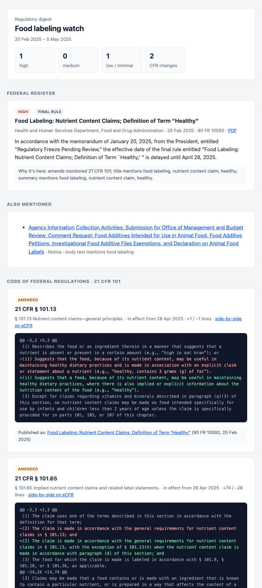

# fedreg-digest

**A weekly digest of the US federal regulations you care about.** Point it at an agency, a few
keywords and the parts of the Code of Federal Regulations that govern your work. It reads the
[Federal Register](https://www.federalregister.gov) and the [eCFR](https://www.ecfr.gov), works out
what is relevant, and writes a plain-language digest. Each item says why it was included, and each
amended regulation comes with a before/after diff.

It works for any agency and any CFR title. The example profiles watch FDA food labeling
(21 CFR 101), FAA drone rules (14 CFR 107 and 89) and EPA drinking-water standards (40 CFR 141 and 142).



## What a run does

1. **Fetches** every Federal Register document from your agencies in the window: final rules,
   proposed rules and notices. It also fetches every rule that amends one of your CFR parts,
   whichever agency issued it.
2. **Scores** each document on where your keywords appear (title over abstract over body text),
   on its type, and on whether it touches a monitored part. Anything with no match is dropped.
3. **Reviews** what is left with Claude, which reads your profile's plain-English `topic` and demotes
   documents that only mention your keywords in passing.
4. **Summarises** the important ones: key points, what changes, and every deadline.
5. **Diffs the CFR.** Every section of your parts amended in the window is compared as it read the
   day before and the day the change took effect, and linked to the rule that made the change.
6. **Writes** the digest as HTML, Markdown, plain text and JSON. Email is optional.

The whole run is about a hundred API calls, and the Claude part costs cents
([cost](docs/how-it-works.md#cost)). AI is optional: `--no-ai` gives keyword scoring and CFR diffs
with no key at all.

## Quick start

Needs Python 3.10 or newer.

```bash
git clone https://github.com/franco-g-s/fedreg-digest.git
cd fedreg-digest
python -m venv .venv && source .venv/bin/activate
pip install -e .

# Try an example straight away. No API key is needed for this.
fedreg-digest run -p profiles/food-labeling.yaml --no-ai --days 30 --open
```

Then make it yours:

```bash
fedreg-digest init               # answer a few questions and get fedreg.yaml
cp .env.example .env        # add ANTHROPIC_API_KEY (and SMTP settings for email)
fedreg-digest doctor             # checks the profile, both APIs, the key and SMTP
fedreg-digest run --open         # this week's digest, opened in your browser
```

`fedreg-digest agencies <search>` finds agency slugs, e.g. `fedreg-digest agencies aviation`. Every command also works under the shorter name `fedreg`.

## A profile

Everything about *what* to watch lives in one YAML file. The code has no domain knowledge.

```yaml
name: Drone operations watch

topic: >
  A commercial drone services company flying small unmanned aircraft under
  Part 107. We care about operating rules, waivers, Remote ID and airspace
  restrictions that affect drones. Rules for crewed aircraft are not relevant.

keywords: [unmanned aircraft, UAS, drone, remote ID, BVLOS, Part 107]

federal_register:
  agencies: [federal-aviation-administration]
  document_types: [RULE, PRORULE]

ecfr:
  title: 14
  parts: ["107", "89"]
```

The `topic` matters most. Claude uses it to decide relevance and to write each summary for
your situation. All options, including scoring weights, thresholds, model choice and email, are in
[docs/configuration.md](docs/configuration.md).

## Running it on a schedule

- **GitHub Actions:** [`.github/workflows/digest.yml`](.github/workflows/digest.yml) runs weekly
  once you add your secrets and set the repository variable `FEDREG_ENABLED=true`. The steps are
  in the file.
- **cron or launchd:** `fedreg-digest run -p /path/to/profile.yaml --email`. A `.env` next to the profile is picked up, so the job does not have to start in that directory.

Either way, the command **exits non-zero whenever the digest is incomplete or could not be
sent**: an API was down, a Claude call failed, or SMTP rejected the login. The digest also lists
these problems at the top. A scheduler will show a failed run instead of a green tick on a
digest that quietly did less.

## Design choices

- **Official APIs only.** No scraping. Neither API needs a key.
- **Stateless by default.** CFR changes come straight from eCFR's version history, so there are no
  snapshots to store and no state to lose between CI runs. A small SQLite cache only avoids paying
  twice for the same AI call.
- **Explainable.** Every item carries its reasons ("amends monitored 21 CFR 101; title mentions
  healthy") and Claude's verdict, if one was given.
- **Failures are loud.** A failed review keeps the document and marks it unreviewed. A failed
  summary is reported. Nothing is silently dropped or silently approved.

More detail, including how scoring works and what it costs, is in
[docs/how-it-works.md](docs/how-it-works.md).

## Development

```bash
pip install -e ".[dev]"
pytest          # offline: recorded API responses, no network or key needed
ruff check src tests
```

## Disclaimer

fedreg-digest helps you notice regulatory changes. It does not interpret them. AI summaries can be
wrong, so read the linked source before acting, and do not treat a digest as legal advice.

MIT licensed. Built by [Franco Gómez Schumacher](https://franco.international).
